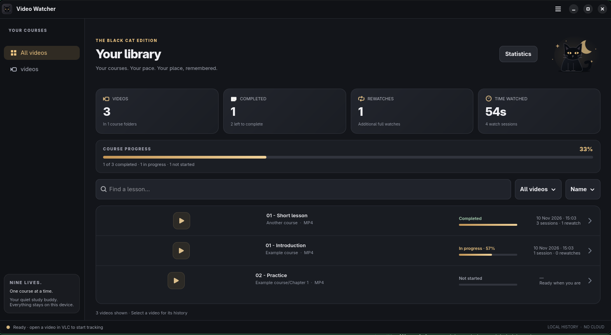

# Video Watcher 🐈

Watch your courses in VLC. Let the cat remember your progress.

A small Linux app with multiple course folders, completion tracking, rewatches, watch dates, useful statistics, and CSV exports. Everything stays on your computer.

Now dressed in midnight charcoal, amber eyes, and a black-cat theme. Add Folder and Settings live in the **☰ menu**.



## Install

Paste this **one line** into your terminal as your normal user:

```bash
bash -c "$(u=https://raw.githubusercontent.com/mathisen99/videowatcher/main/install.sh; if command -v curl >/dev/null; then curl -fsSL "$u"; else wget -qO- "$u"; fi)"
```

The installer handles dependencies, VLC codecs, the app launcher, and starting at login. It may ask for your password to install system packages. It ends with a cat. Obviously.

**Debian 13 is the primary target.** The installer also handles Debian 12+, Ubuntu 22.04+/Mint 21+, Arch-based distributions, and Fedora Workstation. Works with GNOME Wayland and X11. Fedora codec availability depends on your enabled repositories.

## Use it

1. Open **Video Watcher** from your app menu.
2. Add your course folders.
3. Watch their videos in **VLC**.

Brief accidental opens are ignored. Watching 90% of a video's content counts as completed; pausing or skipping does not. Open a video's history or **Statistics** to see when and how much you watched.

**× closes the app and stops tracking.** Want it out of the way? Choose **☰ → Hide and Keep Tracking**. Reopen it from your app menu to return.

**Update:** Close the app, then run the same install command again. For versions before 0.4, use the old **Quit** button first. Your history is kept.

[More details, manual installation, and troubleshooting](docs/DETAILS.md)
